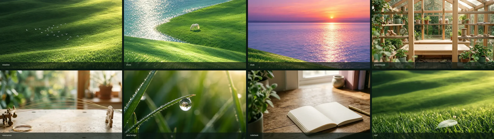

# One living world — generated media

Companion to [One living world — connected video, interaction and page direction](./connected-world-motion-and-video-prompts.md).

**Status:** eight clips, five new still plates and a media/cue manifest exist, reviewed and measured. The inner pages are **not** rewired yet — the page hierarchy pass and the Still / Gentle / Expressive preference are the next phase. No page loads these files today.



## What was generated

Five new plates, all 16:9 or 3:2, from `google/gemini-3.1-flash-image`:

| Plate                                             | Scene                                              | Size       |
| ------------------------------------------------- | -------------------------------------------------- | ---------- |
| `public/workshop/plates/dew-macro.webp`           | macro blade + dew drop with a greenhouse inside it | 1264 × 843 |
| `public/workshop/plates/greenhouse.webp`          | pale timber / glass / brass maker greenhouse       | 1376 × 768 |
| `public/workshop/plates/resonance-room.webp`      | brass strings over a larch workbench               | 1376 × 768 |
| `public/workshop/plates/field-notebook-flat.webp` | flat open notebook, warm ivory paper               | 1376 × 768 |
| `public/workshop/plates/leaf-clearing.webp`       | single pale leaf in a sunlit clearing              | 1264 × 843 |

Eight clips, all silent, all with a poster, a desktop VP9 cut, a mobile VP9 cut and an H.264 fallback:

| Scene      | Role        | Loop | Duration | Desktop WebM | Mobile WebM |     MP4 | Poster |
| ---------- | ----------- | ---- | -------- | -----------: | ----------: | ------: | -----: |
| meadow     | ambient     | yes  | 8.04 s   |      1.78 MB |     0.51 MB | 1.91 MB | 177 KB |
| shore      | ambient     | yes  | 8.04 s   |      1.04 MB |     0.53 MB | 1.39 MB | 161 KB |
| dusk       | ambient     | yes  | 8.04 s   |      1.61 MB |     0.63 MB | 1.52 MB |  99 KB |
| greenhouse | ambient     | yes  | 8.04 s   |      1.47 MB |     0.48 MB | 1.47 MB | 144 KB |
| resonance  | ambient     | yes  | 8.04 s   |      0.38 MB |     0.13 MB | 0.53 MB |  60 KB |
| notebook   | header loop | yes  | 8.04 s   |      0.39 MB |     0.15 MB | 0.55 MB |  60 KB |
| dew-bridge | bridge      | no   | 8.04 s   |      1.64 MB |     0.75 MB | 1.73 MB |  38 KB |
| leaf       | bridge      | no   | 6.04 s   |      1.31 MB |     0.63 MB | 1.18 MB |  76 KB |

Total shipped media: **23.9 MB** across 32 files in `public/workshop/scenes`, plus 0.4 MB of plates. Every clip is 24 fps, H.264 sources stripped of audio, and each desktop cut is under the 2 MiB per-loop budget in the direction document.

## How they were made

Shared recipe, from the production wrapper in the direction document:

1. Approved plate as the **first and last frame** for ambient loops, so the model interpolates out of stillness and back into it. This is the documented looping recipe for the video model and it is why every loop's seam is invisible.
2. Approved start **and** end plate for `dew-bridge`, capped at 10 s by the model.
3. First plate only for `leaf`, which is a one-shot approach.
4. Camera locked, subject list constrained, fixed upper-right light, "no new objects / no text / no interface", and an explicit rest → gather → crest → settle → rest beat schedule in the prompt.
5. Silent output; the audio track the model generates is discarded at transcode time.
6. Review the actual frames, measure motion energy, keep or reject.

The prompts that produced the approved takes are checked in at [`docs/connected-world-media/prompts/`](./connected-world-media/prompts). Rejected variants are kept beside them and named as such (`-v2`, `-v3`, `-v4`).

### Provider notes (read this before regenerating)

- The `OPENROUTER_API_KEY` exported in this shell was stale (`401 User not found`). The working key is the one OpenCode stores in `~/.local/share/opencode/auth.json`.
- The **OpenRouter workspace guardrail currently blocks every video model** and all image models except `google/gemini-3.1-flash-image`. Eight video models (`bytedance/seedance-2.0-mini`, `seedance-2.5`, `google/veo-3.1-lite`, `google/gemini-omni-1.2-flash`, `x-ai/grok-imagine-video-1.5-lite`, `alibaba/wan-3.0`, `kwaivgi/kling-v3.0-std`, `minimax/hailuo-3-max`) and four image models returned `404 … model-ignored-by-guardrail`. That is a workspace setting, not a model or billing problem, and it is configurable at `https://openrouter.ai/workspaces/default/guardrails`.
- So stills went through OpenRouter (`gemini-3.1-flash-image`), and video went through the same skill family's Google fallback using `GEMINI_API_KEY` from `.env.local`. In the Gemini API, Veo 3.1 Preview was retired on 22 October 2026; the current video model there is `gemini-omni-1.2-flash`, called through the Interactions API with first/last-frame inputs.
- Spend: about **$0.47** on OpenRouter (six stills and probes) and roughly **$15** of Gemini video at published per-second rates — that second figure is an estimate, not an invoice. It includes the rejected takes, which is why the review log below matters.

## Measured cues

These are measurements of the encoded files, not prompt intentions. `seam` is the mean absolute luma difference between the first and last frame (0–255); `drift` is the same for frame brightness; `peak` is the strongest frame-to-frame motion.

| Scene      | seam | drift | peak at | motion per second (frame-diff energy)        |
| ---------- | ---: | ----: | ------: | -------------------------------------------- |
| meadow     | 1.59 |  0.43 |  5.29 s | 0.23 0.37 0.48 **0.73 0.63** 0.31 0.30 0.34  |
| shore      | 1.16 |  0.74 |  4.96 s | 0.20 0.31 0.58 2.03 **3.21** 1.36 0.21 0.18  |
| dusk       | 1.45 |  0.41 |  5.29 s | **0.44 0.55 0.57 0.55 0.53** 0.24 0.18 0.21  |
| greenhouse | 1.54 |  0.04 |  4.46 s | 0.37 0.42 1.05 **1.66 1.69** 0.90 0.53 0.72  |
| resonance  | 1.15 |  0.71 |  5.29 s | 0.07 0.09 0.12 0.31 **0.33** 0.18 0.06 0.07  |
| notebook   | 1.04 |  0.26 |  5.00 s | 0.05 0.09 0.15 0.49 **1.16** 0.84 0.29 0.19  |
| dew-bridge |    — |     — |  4.04 s | 0.67 2.89 3.42 **15.26 9.24** 1.45 0.60 0.68 |
| leaf       |    — |     — |  1.46 s | **3.80 6.26 6.08** 3.18 0.85 0.25            |

What this changes in practice:

- **The shared eight-second breath is real but not identical per scene.** The meadow, greenhouse and notebook crest between 3 s and 5 s. The resonance room peaks late, at 5.29 s. The dusk loop is almost flat and only quietens after 5 s. Code should key to `phases` in `lib/workshop/scenes.ts`, which is where these measured windows live, not to a hardcoded 4 s.
- **The dew bridge is a 1.6 s hold, a 3.2 s push, a hard light transition around 3.2–4.8 s, then a 3.2 s landing** on the approved greenhouse plate. The circular aperture in code is what makes that read as a pass-through; do not play the clip and call it a transition.
- **The leaf bridge front-loads its motion.** Contact and leaf response happen in the first 2.6 s, so the visual bridge must hand off to the procedural seedling that early or it will feel late.
- Ambient loops sit at a seam difference of 1.0–1.6 and brightness drift under 0.75, i.e. a hard cut at the loop point would be invisible-ish but still a cut. Play them as loops; do not crossfade two copies.

## Review log — rejected takes

| Take                                | What went wrong                                                                                              | Decision                                                                 |
| ----------------------------------- | ------------------------------------------------------------------------------------------------------------ | ------------------------------------------------------------------------ |
| dusk v1                             | Concentric ripple rings, a visible "stone dropped" event; motion never rested                                | Rejected. v2 with an explicit no-ring, no-droplet prompt replaced it.    |
| shore v1                            | Water edge turned into a white foam band; grass texture crawled                                              | Rejected.                                                                |
| shore v2                            | Concentric rings and a white lace edge along the bank                                                        | Rejected.                                                                |
| shore v3                            | Same white lace, shoreline shape drifting                                                                    | Rejected.                                                                |
| shore v4, 1080p from the 16:9 plate | Faithful frame 1, but the whole meadow re-rendered into carpet texture; would pop against the approved plate | Rejected.                                                                |
| shore v5, 720p, 16:9 plate          | Kept the velvet grass and the horse, but tall out-of-focus blades sprout during the crest                    | **Accepted.** Natural-looking, settles back, seam 1.16.                  |
| notebook v1 (lifted-page plate)     | Page flipped up into a standing sheet                                                                        | Rejected — the plate itself had a lifted page, so the model animated it. |
| notebook v2                         | Page still stood up, plus a triangular fold artifact                                                         | Rejected.                                                                |
| notebook loop, flat plate           | No page movement; only light and the small plant move                                                        | **Accepted.** Page motion is now code's job.                             |
| leaf v1                             | No leaf bend; the seed appeared and vanished; mostly a push-in                                               | Rejected.                                                                |
| leaf v2                             | Seed lands, leaf dips and recovers, seed rests on the leaf                                                   | **Accepted.**                                                            |

Two lessons worth carrying into the next round:

1. **Generating above the plate's native resolution invites invented texture.** The 1536 px shore plate at 1080p was re-drawn as carpet grass; the same plate at 720p stayed itself. Generate at or near plate resolution.
2. **Whatever is in the plate gets animated.** A lifted page in the still becomes a flipping page in the clip. Fix the plate first, then the prompt.

## Deviations from the prompt pack

- **V07 notebook** is an 8 s ambient loop, not a 4–6 s one-shot that settles into a still. Every attempt at page motion became a page turn, so the paper is held still and the title continuity is left to code. The brief's reading priority (stable body text, selection, focus) is unaffected.
- **V02 shore** ships at 1280 × 720 rather than 1080p for the fidelity reason above. It is an interlude, not a full-bleed hero.
- **V04 dew bridge** resolves from macro to greenhouse across roughly 1.6 s of transition rather than a continuous optical warp. The model will not render a physically continuous pass through a drop; the code aperture carries that illusion.
- **V08 leaf** ends on a small camera push with the seed resting on a wider leaf. It is a visual bridge only. The real first platform, the collision and the camera hand-off stay procedural.

## Reproducing

The generation helpers live outside the repo (they are throwaway tooling, not shipped):
`media_gen.py` from the `openrouter-media-gen` skill for stills, and a small Interactions API client for video. Both read `GEMINI_API_KEY` / the OpenCode OpenRouter key. Example:

```bash
# still
python3 media_gen.py image \
  --model google/gemini-3.1-flash-image --aspect-ratio 16:9 \
  --prompt "$(cat docs/connected-world-media/prompts/02-greenhouse.txt)" \
  --out plates/greenhouse.png --yes

# loop: same image as first and last frame
python3 omni.py --prompt-file docs/connected-world-media/prompts/v05-greenhouse.txt \
  --out clips/v05-greenhouse.mp4 --seconds 8 --resolution 1080p \
  --first-frame plates/greenhouse.png --last-frame plates/greenhouse.png

# web cuts
./transcode.sh clips/v05-greenhouse.mp4 public/workshop/scenes greenhouse loop
```

Interaction ids for every take, including rejected ones, are in [`generation-interactions.json`](./connected-world-media/generation-interactions.json).

## The manifest

`lib/workshop/scenes.ts` is the only place that knows which file belongs to which scene. It records, per scene: role, loop intent, measured duration, intrinsic size, plate, the four sources, measured phases, allowed routes, allowed modes, what code still owns, and the measured seam/drift/energy.

It also exposes three small functions the pages are meant to use:

- `sceneForRoute(pathname)` — the page map as data, including the rule that interactive labs (`/learning/string-instrument`, `/learning/procedural-animation`, `/projects/*`) return `null` and keep ownership of their own input.
- `phaseAt(scene, seconds)` — the measured cue window, so light, type and audio can follow the real clip.
- `playbackFor(scene, { mode, reducedMotion, saveData, visible })` — the single decision point. Reduced motion, Still mode, data saving and offscreen all resolve to the poster, with a reason string.

`tests/workshop/scenes.test.ts` checks that every referenced file exists, that phases are ordered and inside the measured duration, that loops meet the seam tolerance, that bridges are the only one-shots, and that every quiet condition collapses to the poster.

```bash
node --import tsx --test tests/workshop/scenes.test.ts
```

## Acceptance against the direction document

| Requirement                                                         | State                                                                                                           |
| ------------------------------------------------------------------- | --------------------------------------------------------------------------------------------------------------- |
| One shared eight-second ambient rhythm, matching first/last framing | Done for six loops; measured windows recorded; resonance and dusk deliberately drift from the nominal 4 s crest |
| Environment lights from the upper right, consistent palette         | Done across all five new plates and all clips                                                                   |
| Locked environmental cameras; movement lives on the wrapper         | Done — every prompt forbids camera motion for loops                                                             |
| One-shot bridges not used as looping backgrounds                    | Done — `dew-bridge` and `leaf` are marked `role: "bridge"`, `loop: false`, expressive-only                      |
| Source, poster, loop intent, duration, measured cues in a manifest  | Done — `lib/workshop/scenes.ts`                                                                                 |
| No nonexistent video URLs                                           | Done — every path is checked by a test                                                                          |
| Silent output                                                       | Done — audio stripped at transcode                                                                              |
| Progressive, immediate content; no loading gate                     | Not applicable yet: nothing is wired                                                                            |
| Skippable, reduced-motion static presentation                       | Policy is implemented in `playbackFor`; the page-level skip and static presentation are not built               |
| Still / Gentle / Expressive preference                              | Types and policy exist; no UI, no persistence                                                                   |
| Page hierarchy, typography, selectable project copy                 | Not started                                                                                                     |

## Next actions, in the order the direction document asks for

1. Build the preference: Still / Gentle / Expressive, persisted, with `prefers-reduced-motion` forcing Still and the existing quiet-mode storage migrated rather than reset.
2. Wire exactly two moments first, as the document instructs: the **meadow loop** on `/` and the **dew bridge** into `/systems`. Both are expressive-gated and both must degrade to their poster.
3. Measure those two on a real phone before wiring the rest.
4. Then the page hierarchy pass on `/projects/[project_name]`, `/systems`, `/learning` and the archive templates — strong `h1`, selectable copy, one motion idea per page — before adding any further footage.
