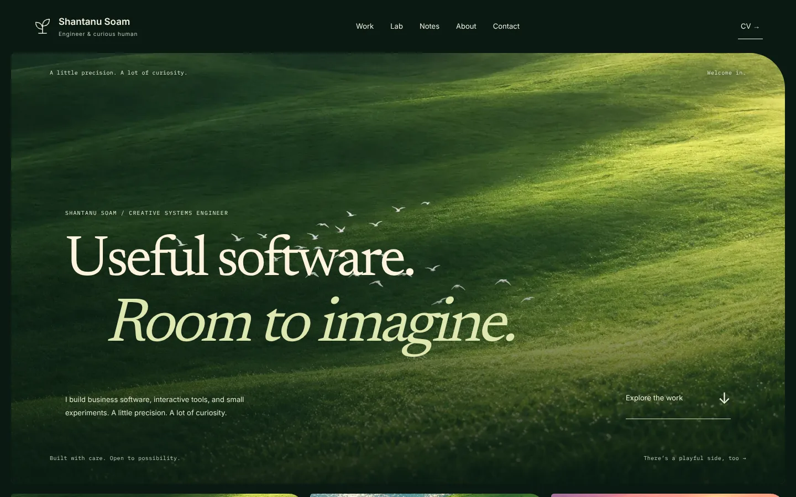
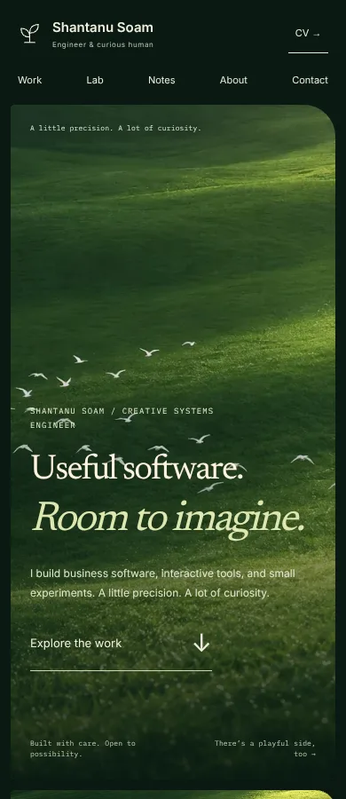
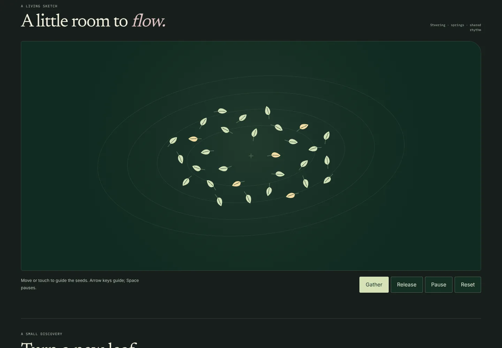
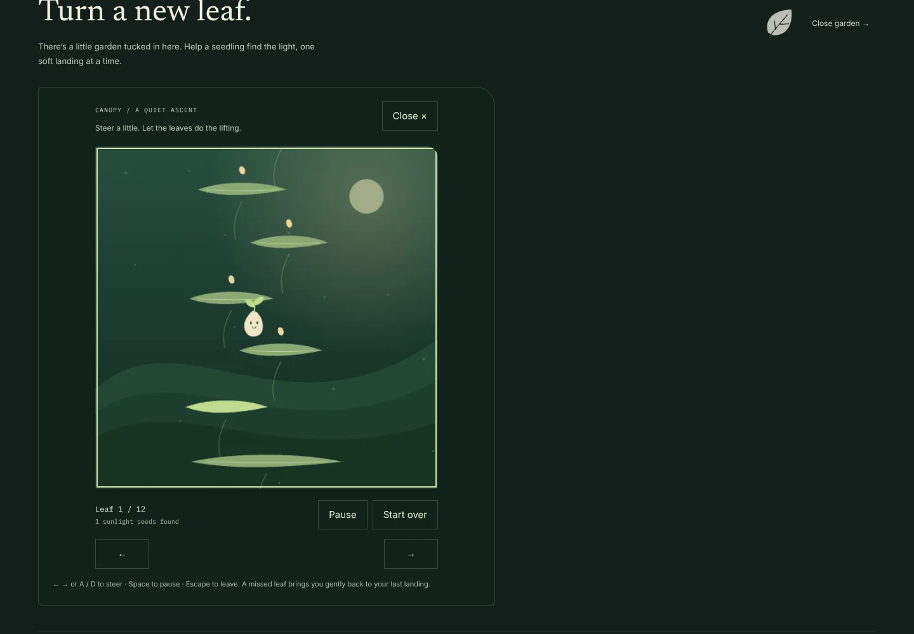

# A quieter portfolio, with a playful side

The November overhaul evolves the existing solarpunk portfolio around a simple rhythm: arrive, understand the work, then choose a moment of play. The supplied recording informed the sense of weight and character in the platform game; its artwork and interface were not copied.

## Work divided between agents

| Job                  | Delivered work                                                                                                                                                        |
| -------------------- | --------------------------------------------------------------------------------------------------------------------------------------------------------------------- |
| Visual refinement    | Inset meadow hero, compact project rhythm, quieter typography and metadata, inline preferences, one coherent clearing for experiments                                 |
| Procedural motion    | Seed flock with separation/alignment/cohesion, spring steering, Gather/Release, shared animation-clock fixes, subtler camera movement, removal of the cursor follower |
| Game and easter egg  | Canopy: an original sprout character, generated leaf platforms, spring deformation, sunlight seeds, forgiving checkpoints and a twelve-leaf destination               |
| Integration          | Footer garden discovery, input ownership across routes, native reading scroll, consistent arrow presentation and browser/build verification                           |
| Independent reviewer | Code, accessibility, lifecycle, physics, responsive screenshots and interaction evidence; findings and final verdict recorded below                                   |

## What changed for visitors

The homepage keeps its real projects, engineering decisions, portrait, writing and contact details. The original landscape art and routes remain. Preferences now sit in the page instead of a fixed panel; the shader study is inside an optional disclosure. Decorative motion is smaller, and an entrance no longer replays when the motion preference changes.

The new clearing contains two experiences:

- **A little room to flow:** thirty seed shapes follow a genuine flocking simulation. Gather brings them into a shared region; Release opens their movement. Pointer, touch and focused arrow keys guide them. Space pauses. The canvas starts only after “Let it grow”.
- **Canopy:** a seedling climbs twelve generated leaf platforms. Left/right or A/D steer, Space pauses, and Escape closes the scene. Touch steering buttons provide the same actions. A missed landing returns to the latest checkpoint. The footer's small sprout reveals the same game without unsolicited popups or sound.

Only one experiment runs at a time. Offscreen, hidden-tab and focus rules stop work where appropriate. Reduced motion and the site's quiet preference leave the flock still and provide Canopy's discrete **Next leaf** journey, so visitors can reach the same destination without continuous animation.

The existing semantic-tree sketch, string instrument, procedural creature labs and arcade routes remain accessible. Interactive routes own their keyboard and audio; archive pages retain search and the soundroom with native scrolling.

## Engineering details

- No new runtime packages, generated sprite assets or external game engine.
- Existing `SecondOrderDynamics` supplies smooth steering and sprout deformation.
- Seeded level generation, swept downward collision, fixed physics steps and bounded elapsed time avoid inconsistent landings and large tab-resume jumps.
- Canvas DPR is capped; game code is dynamically imported on activation. Flock and image rendering use the existing demand-driven clock.
- Fixed duplicate RAF scheduling when a subscriber wakes the shared clock.
- Shader cleanup releases resources without permanently losing a canvas context needed on re-entry.
- Held Space/P events toggle pause only once; game controls do not consume page keys outside their focused region.

## Verification

- Fifteen workshop tests pass: deterministic flocking, six thousand bounded simulation steps, Gather/Release behavior, reachable generated platform layouts, swept collision, checkpoint/restart, still-mode completion, real-physics completion, lighting continuity and existing semantic-tree invariants.
- Full TypeScript and whitespace checks pass independently of Next's existing skip-validation build configuration.
- Chromium browser checks cover widths 320, 360, 390, 768 and 1440; no horizontal overflow was found.
- Browser interaction checks pass for activation, steering, reciprocal experiment handoff, scoped keyboard input, Escape/focus return, footer discovery, still-mode completion/restart, preference changes, shader re-entry and music controls.
- Representative project, systems, blog, motion-lab and pocket arcade routes return HTTP 200 with no page errors in the tested browser session.

Production build and final reviewer evidence are appended after the release checks finish. Real-device Safari/Android performance and field Core Web Vitals have not been measured; no frame-rate guarantee is claimed. The earlier video prompts remain available, and no generated environmental video is represented as part of this code overhaul.

## Final review and production evidence

The independent reviewer approved the integrated overhaul with **no blocking issues** after inspecting the code, desktop/phone/flock/game screenshots and verification evidence. Their held-key recommendation was implemented: repeated Space/P keydown events no longer repeatedly toggle pause. Emoji-capable diagonal arrows were replaced with plain text arrows for consistent presentation.

The full Next production build passed with all 61 pages generated. The homepage reports 127 kB first-load JavaScript; later dynamic chunks, image transfer and gameplay work are additional. The production Chromium suite passed the same interaction and route checks with zero page errors, including a held-key assertion in each new experience.

This is a review-branch update for PR #21. No default-branch merge or production-domain change is part of this delivery.

